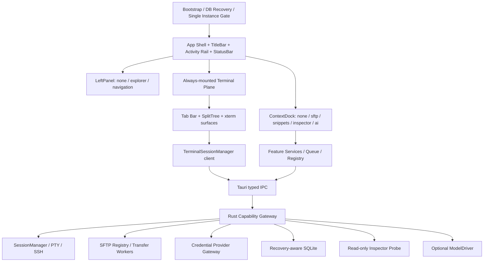

# 02 · Architecture Blueprint、生命周期与不变量

## 1. 总体结构



### 硬边界

- **Shell 只决定展示**：路由、面板、主题、宽度和焦点由 React/Zustand 管理；它不创建或关闭 PTY、SSH、SFTP、AI Run。
- **生命周期服务决定释放**：SessionManager、TransferQueue、CredentialProvider、ExtensionRegistry 和 AgentRunSupervisor 分别拥有自己的资源。
- **Rust Gateway 只接收意图和稳定 ID**：普通 UI 不通过一个万能 `read_secret`、`execute_shell` 或任意路径 API 获得高权限。
- **数据层分三类**：持久元数据、运行时资源、派生 UI 状态必须分开，不把活动远程连接当作恢复数据写入。
- **单一真值**：一个功能只能有一个状态机和一个 owner；UI 是投影，不是第二个资源控制器。

## 2. 资源 Owner 与状态

| 资源 | 创建条件 | Owner | 关键状态 | 取消/超时 | 清理/崩溃恢复 |
| --- | --- | --- | --- | --- | --- |
| Terminal Session | 用户创建 Local/SSH/Serial Tab | Rust `SessionManager`；前端 `TerminalSessionManager` 只映射 | `created → connecting → active → reconnecting → failed → closing → closed` | 连接阶段有共享预算；关闭/退出取消 attempt | 注册 gate 防迟到 session；自然 EOF、显式 close、shutdown 都移除 registry |
| PTY | Local Session 创建成功 | Rust `LocalSession`/portable-pty | `spawned → running → eof/failed → reaped` | spawn/read/write/close 均有界 | kill/wait/reap；不因 React unmount 关闭 |
| SSH Connection | Session 进入 remote connecting | Rust `SshSession`/pool | `tcp → auth → hostkey → channel → shell` | 每阶段 timeout；凭据/HostKey 失败不重试 | transport/channel/writer 一起关闭；generation 拒绝迟到输出 |
| xterm Surface | Tab/Panes 需要显示 | 前端 TerminalContainer | `created → attached → hidden → disposed` | 无网络取消；隐藏不 dispose | 仅关闭 Tab/prune dispose；路由和 Dock 变化只隐藏 |
| SFTP Session | 明确打开 SFTP 或首次文件动作 | Rust `sftp_sessions` + Transfer Lease | `preparing → ready → busy → closing → closed` | channel/handshake/operation 有界 | SessionManager removal listener、shutdown、失败回滚和延迟释放清理 |
| Transfer | 用户确认入队且监听/Lease 已准备 | `TransferQueue`/Rust worker | `preparing → queued → running → finishing → done/error/cancelled` | queued 可取消；running 只有底层支持时显示取消 | Dock 关闭不影响；最终态只转一次；staging 清理和原文件恢复 |
| Credential Provider | 连接或用户保存凭据时 | Provider Registry；秘密只在 provider 内部 | `uninitialized/locked/available/unusable/unsupported` | Provider I/O 有界；不走网络重试预算 | 版本写入→读回→引用切换→旧版退役；失败保留旧引用 |
| Extension Instance | 功能启用且 manifest/capability 校验通过 | `ExtensionRegistry` | `registered → activating → active → deactivating → disabled/failed` | activate/deactivate 有界；异步回调携带 generation | Disposable 全部回收；异常隔离；不触碰核心 Session |
| AI Request | 用户批准 Context Review 后 | `AgentRunSupervisor` | `idle → preparing → running → cancelling → completed/failed/cancelled` | CancellationToken、timeout、stream close | 迟到 chunk 按 runId 丢弃；Dock 关闭不改变 SSH；审批一次性消费 |
| Model Connection | AI Run 需要 profile | `ModelDriver`/HTTP client | `idle → connecting → streaming → closed` | connect/request/stream 各有界 | 不持有 SSH Secret；重试新 runId；不在默认构建启动 |
| Approval | 未来 Tool 或明确发送动作 | Approval service | `proposed → approved/rejected/expired/consumed` | expiry；双击由 action hash 幂等 | 绑定 `runId + hostId + sessionId + actionHash + userGesture` |
| Inspector Probe | 已连接 Host 且用户点击 Refresh | `InspectorSupervisor` | `queued → running → completed/stale/error/cancelled` | 单 probe timeout；Host 切换取消旧 probe | 只存内存短缓存；关闭 Dock 停止不必要采集；旧结果不能写新 Host |

## 3. 事件流和代际

### Terminal I/O

1. xterm `onData/onBinary` 进入唯一 FIFO。
2. UI 只把活动 `paneId/tabId` 映射到 Session ID，不直接调用 Rust session handle。
3. Rust output 带 `sessionId`、generation 和序号；前端 ACK 按实际写入字节返回。
4. 任何 route/panel/resize 变化只触发 Fit/Resize，不创建新的 Session。
5. close/reconnect 退休旧 generation；旧 event、旧 output、旧 promise 不能写入新 Tab。

### SFTP

1. `hostId + sessionId + remotePath` 组成操作绑定；UI 显示名不是安全绑定。
2. `Preparing` 阶段就取得 Lease，直到 queued/running/finishing 结束才允许资源释放。
3. Transfer state 只由 Queue/Rust worker 结算；React cleanup 只能请求 release。
4. Dock 关闭或切 Tab 不修改 Transfer state；最终 done/error/cancelled 才触发 watcher 关闭无其他用途的 SFTP Session。

### AI

1. UI 生成 `ContextSelection`，包含 `hostId/sessionId/bytes/contentSha256` 和可编辑的脱敏文本。
2. 用户批准文本后才构建 `AiRequest`；模型拿不到 Provider Secret 或 SSH Credential。
3. 每个响应 chunk 带 `runId`；切 Host、关闭 Dock、取消后旧 chunk 只可进入该 Run 的终态记录。
4. 未来 Tool Proposal 以完整动作 hash 绑定目标 Session。任何参数变化都使旧 Approval 失效。

## 4. 持久化与内存模型

### 可持久化

- Host 元数据：地址、端口、用户名、认证类型、HostKey 引用、Jump Host ID、标签、非秘密 Profile。
- CredentialRef：provider、version、kind 列表和不可猜的 provider key ID；不保存 Secret。
- Workspace：稳定 `workspaceId`、tab/pane/layout tree、active pane、sidebar width 和 schema version。
- Snippet 元数据和正文；需要区分“插入”与“执行”并记录风险级别。
- Connection Logs、Transfer History 的脱敏元数据、Settings、Model Profile 公共字段。
- Recovery marker、备份和迁移事实；由现有 DB Recovery 机制管理。

### 只存在内存

- PTY、SSH transport/channel、SFTP session、Transfer worker、Lease、file handle。
- 当前 Dock pin、打开的弹层、焦点、selection、当前 AI Context 明文、AI streaming buffer、Approval nonce。
- Provider 解锁的 master key、读取出的 Secret、Model API key 明文。
- Inspector 短时结果可以在内存中带 TTL；不新建历史时序表。

### 不应恢复为自动动作

- 远程 SSH 连接、SFTP session、正在运行的 Transfer、AI Run、Approval、Inspector probe。
- 恢复只恢复布局和元数据；若用户明确选择 reconnect，才启动新的有预算 attempt。

## 5. 数据契约

```ts
interface WorkspaceLayoutV2 {
  schemaVersion: 2
  workspaceId: string
  orderedTabIds: string[]
  activeTabId: string | null
  panesByTabId: Record<string, SplitTreeNode>
  selectedPaneIdByTabId: Record<string, string | null>
  leftPanelPreference: 'none' | 'explorer' | 'navigation'
  sidebarWidthPreference: number
  // right dock presentation and SFTP pin are runtime state, not auto-connect state
}

type SplitTreeNode =
  | { kind: 'leaf'; paneId: string }
  | { kind: 'split'; axis: 'horizontal' | 'vertical'; ratio: number; a: SplitTreeNode; b: SplitTreeNode }

interface CredentialRefV2 {
  provider: 'vault' | 'system-keychain' | 'windows-credential-manager' | 'secret-service'
  version: number
  kinds: Array<'password' | 'privateKey' | 'passphrase'>
  keyId?: string
}

interface TransferRecord {
  transferId: string
  hostId: string
  sessionId: string
  localPath: string
  remotePath: string
  status: 'preparing' | 'queued' | 'running' | 'finishing' | 'done' | 'error' | 'cancelled'
  bytesDone: number
  bytesTotal: number
}

interface ModelProfilePublic {
  id: string
  name: string
  provider: 'openai-compatible' | 'anthropic' | 'local'
  endpoint: string
  modelId: string
  temperature?: number
  maxOutputTokens?: number
  timeoutMs: number
  streaming: boolean
  secretRef: string | null
}
```

这些是目标契约，不是立即替换当前数据库的 drop-in schema。每个新字段都必须通过 migration adapter 加入，保留旧读取路径和回滚证据。

## 6. IPC 权限分层

### Core Session Gateway

允许：创建带明确 Host/认证意图的 Session、写入已绑定 Session ID、resize、close、读取结构化状态。禁止把任意 shell command 作为“方便 API”暴露给 UI。

### SFTP Gateway

允许：传递已确认的 `sessionId/hostId/path`，执行类型化文件操作，接收进度。路径按本地/远端语义分别处理，不能把参数拼成 shell command。

### Credential Gateway

目标状态：UI 传 `resourceId + operation intent`，Rust/Provider 解析 Secret；UI 不通过通用 `vault_get(key)` 取得任意密钥。迁移完成前保留兼容路径，但禁止给 Extension/AI 复用。

### Extension/AI Gateway

默认拒绝：任意 FS、SQL、网络、Vault/Keychain、SSH Secret、raw PTY、自动远程执行。允许的能力必须在 manifest/profile 中声明，带一次性用户操作、目标 Session 和审计 ID。

## 7. 性能和启动预算

- 首个本地终端是最高优先级：AI、Inspector、Extension、SFTP、系统 Provider 的静态 import 和后台任务必须在懒加载/feature gate 后。
- 首个可输入时间按真实 Tauri + PTY 测量；目标是当前固定环境基线不退化，不能用 DB recovery healthy 代替终端可输入。
- Terminal 输出继续使用已有有界泵、ACK、高低水位和 UTF-8 边界；任何 UI 重构都不改协议。
- 终端 Shell、xterm core 和应用 Shell 的 bundle 必须分开报告 Initial/All gzip/raw；新增 Rig/markdown/图表依赖必须报告增量。
- 4 Pane、活跃 SFTP、Explorer、Dock、Inspector 和 AI 同时运行要分别测内存、线程、网络和 Session 数，不能只测空闲窗口。
- Layout 算法使用真实 Shell 宽度和 xterm cellWidth；Terminal 优先保留 60 cols，无法满足时把次要面板转 overlay 或提示，而不是裁切终端。

## 8. 统一不变量

保留并持续门禁 UX-0 的 `INV-1`～`INV-16`：

1. 全局只有一个 `data-terminal-workbench`。
2. 一个 `tabId` 最多一个 `TerminalContainer`。
3. 切 Tab/路由不卸载已挂载 Pane。
4. 终端层保持挂载，ACK 不因隐藏中断。
5. 终端可见性只有一个裁决函数。
6. Workspace 持久字段完整保全。
7. Recovery persistence 订阅点不能丢。
8. `prune` 根据完整 Tab 集合关闭，不根据当前路由关闭。
9. Tab ID 跨恢复稳定。
10. 全局快捷键、xterm 放行、路由作用域三层保护同时存在。
11. 输入/输出只有一条有序通路。
12. 窄窗口与侧栏由单一响应式裁决。
13. SFTP Host 显式绑定，Pin 不随焦点静默改写。
14. Dock/Tab 变化不终止活跃传输。
15. Bootstrap/Recovery Gate 是布局祖先。
16. 指纹路径改动使旧证据失效，必须官方流程重采。

追加 `NEXT-01`～`NEXT-10`：

- 任何在线/健康/速度/最近连接都带真实来源和时间语义。
- 一次拖放只有一个有效上传触发器。
- SFTP Registry 关闭后无残留，释放幂等。
- 小窗口优先保持终端可输入；不能满足 60 cols 时明确提示。
- Compact Dock 只渲染一个可聚焦文件 Pane。
- 模型输出不等于可执行动作；Approval 是一次性、可校验的。
- AI Secret 与 SSH CredentialRef 命名空间隔离，日志无明文。
- 跨平台 GUI 以真机证据为准，测试通过不等于产品可用。
- 未启用功能不产生后台网络/CPU/Session 开销。
- 未知 Provider/损坏引用原文保留并 fail-closed，绝不清空。
