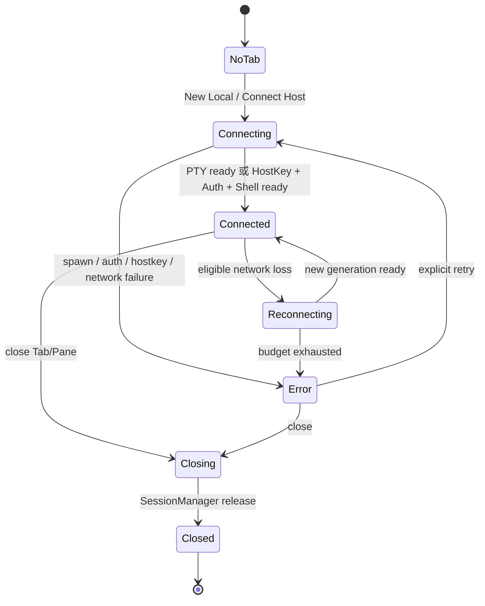

# 04 · UX-1 Terminal Workspace

## 1. 目标和判定

UX-1 的目标不是重新做一个视觉壳，而是在当前已合入的 UX-1a/1b/1c、F0、SFTP 和 GUI harness 基础上，把 Terminal Canvas 变成稳定的工作台主体。当前实现已满足大部分结构性目标；剩余工作主要是当前 HEAD 的原生桌面证据、跨平台交互、细节一致性和后续 Dock occupant 的扩展契约。

判定：

- `TERMINAL_WORKSPACE_CODE = IMPLEMENTED`
- `TERMINAL_LIFECYCLE = PARTIAL`：显式 close/shutdown 有清理通知，但自然 EOF/远端断开 cleanup 尚未覆盖 removal listener
- `SFTP_DOCK_LIFECYCLE = PARTIAL`：Dock/Queue/Lease 语义已实现，重复 `sftp_connect` 和自然断开注册表清理仍需闭合；真实产品路径证据按运行 SHA 单独记录
- `NATIVE_GUI_CURRENT_HEAD = UNVERIFIED`
- `IME_AND_PHYSICAL_KEYBOARD = UNVERIFIED/BLOCKED_EXTERNAL`
- `TABBY_REPLACEMENT_READY = NO`

## 2. 当前实现复审

### 已保留

- `MainLayoutContent` 同级挂载 Activity Rail、LeftPanel、Terminal Canvas、RightPanel 和 StatusBar。
- `TerminalByUrl` 是常驻层；路由变化通过 `isTerminalPath`/`terminalTabPath` 处理，不创建第二个 TerminalContainer。
- `leftPanel: none|explorer|navigation` 消除了 Rail 与永久导航侧栏双轨。
- `rightPanel: none|sftp` 采用单占位者规则；新增 Snippet/Inspector/AI 时必须扩展这个 union，不得添加并行布尔量。
- `usePanelLayout({ explorerWidth })` 传入 LeftPanel 实际宽度，使用 Shell ResizeObserver、cellWidth、chrome width 和 hysteresis；现有实现需要补收缩/恢复对称回归，证明不会单向卡在 drawer/overlay。
- Connection Explorer 的 Recent 来自 `connection_logs`；连接路径复用 `useConnectToHost`。
- SFTP binding 明确 Pin/Follow 语义，Transfer Queue 和 Rust SFTP Registry 不由 Dock React cleanup 直接拥有。
- SessionManager 显式 close/shutdown 通过 removal listener 清理 SFTP registry；自然 completion cleanup 当前直接移除 registry，重复 `sftp_connect` 当前会覆盖旧 entry。Transfer Queue、staged upload/download、真实 OpenSSH fixture 和产品 E2E 已有多层覆盖，但这两个退出/初始化边界仍需单独证据。

### 不能误报为完成

- 参考图不是应用截图；v2 的旧 SHA 不是当前基线。
- 最近成功的 Native GUI E2E 不在当前 `main` SHA 上；当前 HEAD 必须按最终设计/代码冻结后重新采集。
- 浏览器/组件测试不能替代真实 macOS/Windows 窗口、DPI、物理键盘、IME、Vim、tmux、焦点和 Window Controls。
- UX-1 不等于完整的 Snippets/Inspector/AI Dock；当前右 Dock 只实现 SFTP。
- 7 天真实日用和正式发布证据仍独立于代码完成。

## 3. 工作台结构

```text
App Shell
├─ TitleBar
├─ ActivityRail (46/48px)
├─ LeftPanel (none | explorer | navigation)
├─ TerminalPlane (always mounted after first Tab)
│  ├─ TabStrip
│  └─ SplitTree
│     └─ TerminalPane (xterm + pane header + pane error)
├─ ContextDock (none | sftp | future occupants)
└─ StatusBar
```

### 默认态

- 初次启动完成 Recovery Gate 后，不因无 Host/Vault 而阻塞 Local Terminal。
- 无 Tab 时显示明确 New Local CTA；创建第一个 Tab 后 Terminal Plane 常驻。
- Explorer、Dock 默认关闭；Terminal Canvas 取得最大宽度并聚焦。
- StatusBar 只显示有真实来源的值：active pane 的 Session type、状态、cols×rows 和 live transfer count。**当前实现刻意没有 encoding 和 shell name 字段**（`components/status-bar/index.tsx` 注明“nothing in the app reports either as a verified fact today”，并有测试断言不渲染）；编码只能作为未来目标，在出现真实数据源之前不得写进当前 UI 规格。

### 展开态

- Explorer 和 Dock 可同时请求打开，但由布局算法决定 column/overlay/hidden。
- Terminal 预测少于 60 cols 时，先让 Dock overlay，再折叠 Explorer；不删除用户的宽度偏好。
- Pane header 的错误只覆盖对应 Pane，不能变成全局 toast 或覆盖整个窗口。

## 4. 用户流程

### 打开并连接

```text
Bootstrap/Recovery Gate
  → Local Terminal 可输入
  → Rail: Connections
  → Search/Recent/Favorites/Groups
  → 明确 Connect
  → HostKey + Credential Guard
  → 新建 Tab / Session
  → Focus Pane
```

Explorer 切换不离开 Terminal route；点击管理页的 Host 只打开详情，Connect 是显式动作。

### Tab/Split

- 新建 Local/SSH Tab 使用稳定 `tabId`。
- Split 创建新的 Pane/Tab 映射，不能复用一个 Session 的输出到两个 xterm；当前每个 SplitGroup 只允许两个 Pane。
- Core 的 2×2/4 Pane 不属于当前实现或验收目标；未来扩展必须先改 SplitTree、焦点、关闭、恢复和真实输入证据，再改 UI 入口。
- active Pane 决定输入目标、命令面板、Snippet 和当前状态栏。
- 关闭 Pane 是 Session close；关闭 Dock 是 view close，两者必须在 UI 上有不同语义。
- Workspace 恢复布局和 Tab 元数据，不自动重连未知远程 Session；用户明确 reconnect 才创建新 attempt。

### SFTP Dock

- Rail Files 在 Terminal route 打开 Dock；`/sftp` 仍是完整深链。
- 首次打开默认取当前有效 SSH Host；用户 Pin 后切 Tab 不改绑定。
- Follow Active Tab 是明确动作，显示即将切换的 Host。
- 上传/下载入队前先建立 Lease；关闭 Dock 只隐藏视图，传输继续。

## 5. 类型与接口契约

```ts
type LeftPanelMode = 'none' | 'explorer' | 'navigation'
type RightPanelMode = 'none' | 'sftp' | 'snippets' | 'inspector' | 'ai'

type WorkspacePresentation = {
  left: 'none' | 'column' | 'drawer'
  right: 'none' | 'column' | 'overlay'
  predictedCols: number
  limitingReason?: 'width' | 'font-size' | 'mobile'
}

type TerminalPaneState = {
  paneId: string
  tabId: string
  sessionId: string | null
  /** 必须等于 TerminalSessionStatus（见 02 的唯一权威定义）；不要在此另立枚举。 */
  status: 'idle' | 'connecting' | 'reconnecting' | 'connected' | 'disconnected' | 'error'
  hostId: string | null
  cols?: number
  rows?: number
  generation: number
}

type SftpBinding = {
  hostId: string | null
  sessionId: string | null
  pinned: boolean
  differsFromActiveTab: boolean
}
```

`RightPanelMode` 的未来 occupant 必须注册自身的 mount/unmount 视图协议，但不能获得 Terminal Session owner 权限。SFTP operations 必须由 `TransferQueue`/service 层提供，不把 `releaseSession()` 直接放进组件 cleanup 作为唯一清理机制。

## 6. 生命周期状态机

> 节点名必须落在 `TerminalSessionStatus` 的六个值内（见 `02` 的唯一权威定义）。本图额外画的 `NoTab`、`Closing`、`Closed` 是**展示层概念**（Tab/Pane 是否存在、是否正在释放），不是 Session 状态值；不要把它们加进 `TerminalPaneState.status`。



`idle` 是无活动连接的初始值，`disconnected` 是连接丢失但尚未进入重连预算的终态；两者都由 `TerminalSessionStatus` 定义，不要在 UI 里另造同义词。

`RouterHidden`、`ExplorerOpen`、`DockOpen`、`ThemeChanged` 和 `WindowResized` 都不是状态机中的 close 事件。它们只改变展示或发送 resize。

## 7. 布局和响应式验收

| 场景 | 必须测量 |
| --- | --- |
| 1440×900 Focus | 真实 xterm cols ≥120，TerminalContainer 不重建 |
| 1024×768 Focus | 真实 cols ≥80 |
| Explorer 420 + Dock + 大字体 | 实际决策，必要时 overlay/折叠，不能假称 ≥60 |
| 512×370 | 所有 Drawer 可关闭，Terminal 仍可输入，错误可见 |
| 390×844/360×800 | BottomNav、移动会话栏、安全区和长按菜单可用 |
| 100 次切 Tab/开关 Dock | PTY/SSH/SFTP/监听器数量不增加，ACK 继续 |
| 100 次分屏拖动 | 两 Pane 的 cols/rows 最终与 DOM 一致，无 remount/thrash |
| 反复窄化/放宽 | hysteresis 收缩与恢复均可达，不单向锁在 drawer/overlay |
| 125%/150% DPI | Window Controls、Dialog、Focus ring、Tab labels 不遮挡 |

## 8. UX-1 剩余实现任务

这些不是“从零重做 UX-1”，而是可独立审查的补齐任务：

1. **UX1-NATIVE-01：当前 HEAD 原生 GUI 复采**：冻结最终代码后重跑 Focus/Explorer/Dock/Split/Host Error/Keyboard/Window Controls，证据绑定当前 SHA。
2. **UX1-NATIVE-02：macOS/Windows 输入矩阵**：物理重叠键、中文 IME、Option/dead key、Vim/tmux、系统粘贴和焦点恢复；没有设备时保持 `BLOCKED_EXTERNAL`。
3. **UX1-UI-03：occupant 迁移测试**：新增 Snippet/Inspector/AI 前先让 `RightPanelMode`、单占位者和关闭不影响 Session 的测试成为公共契约。
4. **UX1-REVIEW-04：持续资源回收**：对 SessionManager、SFTP Registry、Transfer Queue、拖放 listener 和 GUI harness 的证据继续保留，不在视觉 PR 中重写。
5. **UX1-LIFECYCLE-05：自然退出与重复初始化**：让自然 EOF/远端断开、显式 close、shutdown 都触发同一 removal contract；重复 `sftp_connect` 明确返回幂等成功或结构化 `AlreadyConnected`，不得静默覆盖旧 entry。现有 `every_removal_path_notifies_listeners` 的注释比测试强（只断言两条路径），必须先补 `simulate_natural_eof` 的第三段断言，否则修复没有回归保护。
6. **UX1-LAYOUT-06：对称 hysteresis 回归**：用窄化→恢复→再窄化和 panel mode 改变矩阵锁住双向可达性；用户主动打开/关闭面板不应被宽度阻尼吞掉。
7. **UX1-GUI-07：SFTP fixture 隔离**：每个 GUI spec 使用同一 `GUI_E2E_HOME` seed 和 app profile，先断言数据库路径、主机行和 SFTP 端口，再判断产品 UI 是否缺失主机。

## 9. UX-1 完成定义

- 当前已有的 UX-1a/b/c、F0、SFTP 和 Session 代码保持不倒退。
- 16 条 `INV` 与 `NEXT` 不变量在变异测试和真实链路中可测。
- 当前最终 SHA 具备 Level 1/2 证据，至少一套 macOS 和 Windows Native GUI 证据，所有缺失平台明确标注。
- UI 参考图只用于检查层级/密度/平台风格；真实数据和状态由应用提供。
- UX-1 不要求 UX-2、UX-3、UX-4 的生产实现才能合入，但必须预留明确的 occupant、Gateway 和生命周期边界。
