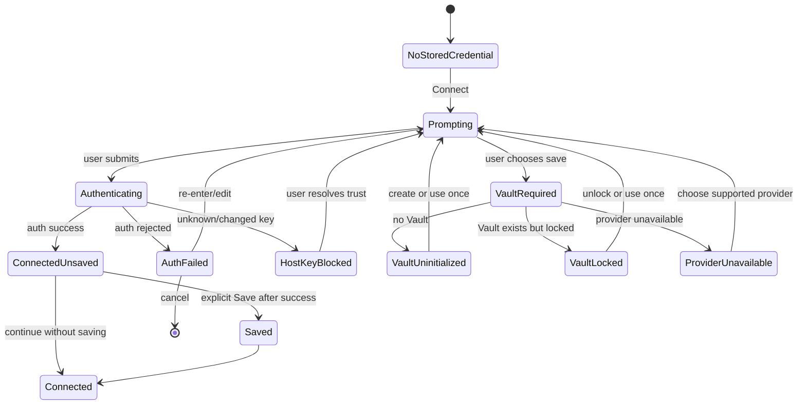

# 05 · UX-2 Credential Experience & Secure Storage

## 1. 目标与当前判定

UX-2 要让用户在第一次连接前不必先理解 Vault，也不牺牲安全边界：用户可以先输入本次凭据并连接，连接成功后再明确选择是否保存；之后可以查看存储状态、更新、切换认证方式或清除。

当前判定：

- Vault 加密存储、版本化写入、Host/SSH key 命名空间、结构化锁定/未初始化/不可用状态：`IMPLEMENTED`。
- Host/SSH key 与实际连接的 resolver 链路：`PARTIAL/UNVERIFIED`。Host 侧有真实 sshd 和 Upgrade E2E 证据，但 SSH key 损坏/未知 provider 仍可能被 mapper 压成 `null`；三平台 GUI 仍分层。
- 认证与保存完全分离、首次连接内联保存状态机：`PARTIAL`，需要 UX-2a 的产品化表单流程。
- 损坏 CredentialRef 的可恢复清除：`PARTIAL`。当前 HostDialog 只在可解析且存在 kind 时显示 Clear，损坏引用可能既不能读取也不能清除；UX-2a 必须提供不依赖解析成功的“移除存储引用/重新绑定”路径。
- 多 Provider Registry、按 `ref.provider` 分派、系统 Keychain/Windows Credential Manager/Secret Service：`DESIGN_ONLY`。
- 系统 Provider 作为默认存储：`BLOCKED`，缺跨构建/升级/回退稳定读取证据。

## 2. 用户状态机



关键规则：

- `Authenticate` 不等于 `Save`；连接失败不保存错误凭据。
- “只本次使用”不产生 CredentialRef，不写 SQLite/localStorage。
- 保存失败保留原输入、Host 表单和当前 Session，不伪造成功；用户可以创建/解锁/切换 Provider 后重试同一 payload。
- Vault 锁定、Provider 不可用、SSH Auth Failure、HostKey Failure、TCP Failure 是不同错误类别，只有网络类别进入自动重连预算。
- Jump Host 和目标 Host 各自解析 CredentialRef；不能因为目标连接成功而把跳板凭据混入目标。

## 3. 认证方式体验

### Password

- 表单允许一次性 Password；Save 复选/按钮必须明确写入哪个 Provider。
- 连接成功后只显示“已连接”；保存必须有单独确认，不把提交表单暗示为已保存。
- Password 与 SSH key passphrase 的 `CredentialKind` 分开；从 password auth 切到 key auth 时不能把旧账户密码误当私钥 passphrase。

### Private Key

- UI 选择/粘贴私钥，路径只是导入输入，不是连接时隐式读取的凭据。
- `identityFilePath` 未 materialize 时 fail-closed，提示用户显式选择/粘贴或使用 Agent。
- 私钥和 passphrase 可以一起保存，也可以只使用一次；列表/导出不返回私钥内容。

### SSH Agent

- Agent 是外部认证源，不要求 Vault；Agent unavailable 是 provider/环境错误，不是空密码。
- UI 显示 Unix socket/OpenSSH named pipe/Pageant 具体来源和可恢复建议。
- Agent forwarding 仍是独立 opt-in，不和“用 Agent 登录”混淆。

### SSH Certificate

- 证书是公开连接配置；私钥和 passphrase 仍走独立 CredentialRef。
- 证书/私钥/跳板端配置分别校验；缺失凭据在网络前拒绝。

## 4. Provider 架构

### 4.1 类型

```ts
type ProviderId =
  | 'vault'
  | 'system-keychain'
  | 'windows-credential-manager'
  | 'secret-service'

type CredentialKind = 'password' | 'privateKey' | 'passphrase'

type ProviderAvailability =
  | { state: 'available' }
  | { state: 'uninitialized' }
  | { state: 'locked' }
  | { state: 'unsupported'; reason: string }
  | { state: 'unusable'; reason: string }

interface SecretProvider {
  readonly providerId: ProviderId
  availability(): Promise<ProviderAvailability>
  read(resource: CredentialResource, version: number, kind: CredentialKind): Promise<string | undefined>
  write(resource: CredentialResource, version: number, kind: CredentialKind, value: string): Promise<void>
  remove(resource: CredentialResource, version: number, kind: CredentialKind): Promise<void>
  removeVersion(resource: CredentialResource, version: number, kinds: CredentialKind[]): Promise<CredentialKind[]>
}

interface ProviderRegistry {
  get(provider: ProviderId): SecretProvider | undefined
  listAvailability(): Promise<Array<{ provider: ProviderId; availability: ProviderAvailability }>>
}

type CredentialRefRead =
  | { state: 'none'; ref: null }
  | { state: 'valid'; ref: CredentialRefV2 }
  | { state: 'corrupt'; ref: null; reason: 'malformed' | 'unsupported-provider' | 'unsupported-version' }
```

`SessionCredentialResolver` 必须根据 `CredentialRef.provider` 分派，而不是在构造时固定一个 Vault provider。未知 provider 的结构化错误是 `unsupported-provider`，不能归类为 Vault locked，也不能转换成空引用。Host 和 SSH key mapper 都必须返回上述三态；`corrupt` 仍然要让 UI 看见清除、导出保留和重新绑定动作，不能因为 `ref` 为 `null` 就被当成 `none`。

### 4.2 CredentialRef

```ts
interface CredentialRefV2 {
  provider: ProviderId
  version: number
  kinds: CredentialKind[]
  keyId?: string
}
```

- `host:<id>:<version>:<kind>`、`ssh-key:<id>:<version>:<kind>`、`model:<id>:<version>:apiKey` 使用独立 namespace。
- System provider 的 `keyId` 由 provider 生成，不复用 Vault key 规则。
- 版本是 provider resource 的 generation；不能用固定数字猜测当前版本。
- parser 必须保留未知 provider/version 的原始摘要或安全编码，不能读失败就写 `null`。
- `privateKey`、`passphrase`、`password` 从不出现在 `CredentialRef` 里。

## 5. 连接与保存契约

### 连接

```ts
resolve(hostMetadata)
  → if inline secret exists: use once
  → else if no ref: prompt / Agent
  → else parse ref fail-closed
  → ProviderRegistry.get(ref.provider)
  → provider.availability()
  → read exactly ref.kinds
  → no missing kind tolerated
  → SSH/Jump Host resolver
```

任何 `read` 报错、缺失 kind、损坏 ref 或未知 provider 都不能以空密码、空私钥或 Agent fallback 继续认证。

### 保存

```text
snapshot old ref
→ choose provider explicitly
→ allocate version
→ write all new kinds
→ read back all new kinds
→ atomically update row reference
→ retire old version best effort
```

SQLite 与 Provider 没有跨系统事务，因此安全保证是“行只指向完整旧代或完整新代”，而不是假装两边原子提交。写入失败必须清理本次新代；清理失败要记录 orphaned ciphertext，但不能删除仍被旧 ref 使用的旧代。

### 清除/切换

- 清除：先让 Host/SSH key 行失去引用，再删除旧 Provider secret；删除失败只能留下无引用密文，不能留下悬空引用。即使引用损坏或 provider 未知，也必须能执行“清除行上的引用”并把无法寻址的密文记入 rebind/cleanup 报告；不能要求先成功解析才显示清除入口。
- `authType` 切换：只丢弃旧认证方式不再使用的 kind；key auth 下的 `passphrase` 仍可以保留。切换 password→key、key→agent、agent→password 均要按旧/新认证方式的 kind 集合计算，而不能按当前 authType 一刀切或用 `COALESCE` 静默保留旧 ref。
- Provider 切换：新 Provider 写入、读回、更新 ref、确认新 ref 可读后，才退役旧 Provider。失败保留旧 ref。
- 删除 Host/Key：先删除引用行，再 best-effort 清除 Provider；UI 报告“配置已删除/秘密清理待完成”而不是重复删除。

## 6. Provider 选择与平台策略

### 推荐顺序

1. UX-2a 先完成 provider 无关交互，继续让现有 Vault 作为唯一生产 provider。
2. 实现 Provider Registry 和窄 Gateway，加入内存 fake provider、真实 Vault provider、错误/回滚负向测试。
3. 做 macOS Keychain、Windows Credential Manager、Linux Secret Service 的独立 Spike，不改变默认 Provider。
4. 只有稳定访问门禁通过后，产品负责人再决定是否把系统 Provider 作为默认；否则继续 Vault，并提供明确的可用性状态。

### 稳定访问门禁

每个平台必须用真实打包应用、真实签名/身份和隔离 profile 证明：

1. 新构建写入。
2. 退出并重启读取。
3. 升级到新构建读取旧条目。
4. 回退到旧构建时，未知 provider/ref 被安全保留而不是清空。
5. 安装路径、Identifier、签名身份变化后的行为有明确结果。
6. 系统拒绝/用户取消不会写半条 secret，也不会把错误转成网络重试。

Developer ID/Authenticode 是公开分发的实际建议，但设计不能把购买证书当作抽象本身；门禁需要真实证据。

Linux 没有统一“Keychain”时，必须明确 Secret Service/平台支持矩阵。不可用时保留 Vault，禁止静默落 plaintext。

## 7. 导入、导出和迁移

- 普通 JSON 导出是 Host/Workspace 配置备份，不是凭据备份；不包含 Secret。
- Unknown provider、损坏 ref、未来 version 必须保留或 fail-closed 并进入 rebind 报告，不写 null。
- Replace 导入要在 UX-2a 定义 `secretPolicy`：`preserve-existing`、`clear-with-explicit-confirmation` 或逐项处理。当前 `COALESCE` 是安全兼容行为，不应伪装成完整 replace 语义。
- 明文→Vault 的既有迁移与 Vault→系统 Provider 的新迁移分开；迁移计划不携带 Secret，执行时从受保护来源读取。
- provider migration 的每一步都有事务 ID、旧 ref、新 ref、已写 kind 和补偿结果；应用重启后可重试且幂等。
- 历史 WAL/backup 中的明文清理是独立授权和证据任务，不随设计 PR 自动执行。

## 8. 威胁模型与安全不变量

禁止：

1. Secret 进入 SQLite、localStorage、普通 Zustand、URL、日志、遥测、错误对象、崩溃报告或导出文件。
2. Secret Provider 以外的普通 UI/Extension/AI 读取任意 Secret。
3. 不支持 provider 自动降级到 Vault、Agent 或空凭据。
4. Host A 引用 Host B 的 secret namespace。
5. 清除/迁移先删旧 secret 再更新 row。
6. 错误凭据认证失败后自动保存。
7. Vault locked/unusable 进入网络自动重连。
8. AI Context 或 Extension event 偷渡 Secret、环境变量、完整 scrollback。

当前 `vault_get` 是可信单 WebView 下的兼容路径；扩展/AI 上线前必须通过 Capability Gateway 限制资源和调用者，并保持 `docs/phase-b/b01-vault-ipc-boundary.md` 的事实边界。

## 9. 测试矩阵

### Level 1/2

- parser：空、合法、未知 provider、未来 version、错误 JSON、空 kinds、恶意类型。
- provider：available/locked/uninitialized/unsupported/unusable、read missing、decrypt failure、write failure、delete failure。
- lifecycle：部分更新、认证切换、Agent、Jump Host 两边、清除（含损坏/未知 ref）、重复迁移、进程中断后重试；逐 kind 断言“不重输的仍保留、切换后旧方式不误带入”。
- 真实 SQLite：Host/SSH key 写入 SQL 的秘密列仍为字面 `NULL`；导入/导出真实 `run_import` 不静默丢 ref。
- 真实 sshd：password/key/agent/cert/Jump 成功和错误路径，不用 CLI 测试替代 Tauri launcher 链路。

### Level 3/4

- Vault UI：首次创建、锁定、解锁、保存失败恢复、清除和切换认证。
- macOS Keychain：同身份重启/升级/回退。
- Windows Credential Manager：隔离 profile、安装器升级、权限拒绝。
- Linux provider：Secret Service 可用/无 DBus/拒绝授权；无 provider 时 Vault fallback 仍安全。
- 真实安装升级：旧 Vault/ref/backup 保留；未来 provider 由旧版安全拒绝。
- 日志扫描：Secret 不出现在 Rust log、前端 console、CI artifact、AI payload 和错误文案。

## 10. UX-2 完成定义

- 用户可以连接一次而不先创建 Vault，也可以在成功后明确保存。
- 保存失败保留原表单，Vault/Provider/网络/认证错误各自有正确操作。
- 连接、Jump Host、SFTP/exec 共用 resolver 语义。
- 多 Provider 的读写、迁移、清除、导入导出和回滚有真实负向证据。
- 在系统 Provider 稳定门禁通过前，默认仍是 Vault；产品文案不会暗示系统钥匙串已经可用。
