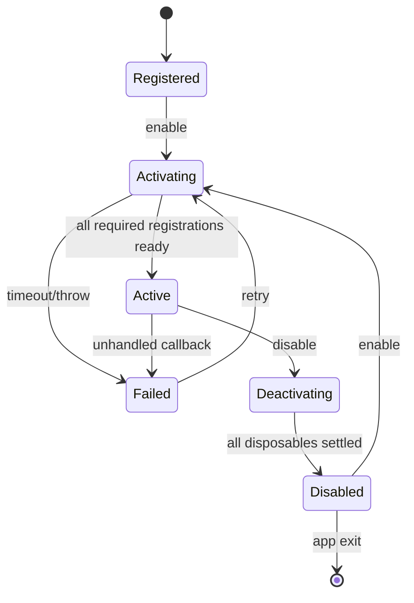

# 06 · UX-3 Extension Platform

## 1. 目标和边界

UX-3 的第一版只解决一个问题：让已经存在的功能可以用稳定的注册、开关、Disposable 和 Capability 契约逐步接入 Terminal Workspace，而不把终端核心重写成插件运行时。

当前全仓没有生产 Extension Registry、Manifest、SDK、Extension Instance 或 Capability Gateway。命令面板、Activity Rail、Right Dock、Workspace events 和 Tauri commands 是可复用的现有表面，但不能被误称为已经具备插件平台。

### 明确分层

| 层 | 第一版处理方式 |
| --- | --- |
| Trusted built-in | 编译进应用，主 UI 中运行，受 TypeScript 类型和 Registry 约束 |
| Optional AI/Inspector | 作为内置扩展接入 typed Gateway，不直接拥有 Session/Secret |
| Community JS | 不在主 WebView `eval/import()`；本阶段不实现 |
| Future external extension | 独立进程或 WASM + Capability Broker，另立安全设计和威胁模型 |

主 WebView 是高权限可信代码。把动态第三方 JavaScript 加载进去不会产生安全隔离，不能写成“沙箱已完成”。

## 2. v0 SDK

```ts
interface Disposable {
  dispose(): void | Promise<void>
}

type ExtensionId = string
type BuiltInViewId = 'snippet-dock' | 'server-inspector' | 'ai-dock'

type ExtensionContext = {
  extensionId: ExtensionId
  apiVersion: 1
  subscriptions: Disposable[]
  commands: {
    register(def: {
      id: string
      titleKey: string
      keywords?: string[]
      when?: () => boolean
      needsConfirmation?: boolean
      run(input?: unknown): Promise<unknown>
    }): Disposable
  }
  menus: {
    register(def: {
      location: 'terminal.context' | 'connections.context' | 'transfer.context'
      commandId: string
      when?: () => boolean
    }): Disposable
  }
  views: {
    register(def: {
      id: string
      titleKey: string
      slot: 'right-dock'
      builtIn: BuiltInViewId
    }): Disposable
  }
  events: {
    on(
      event: 'session.connected' | 'session.disconnected' | 'workspace.changed' | 'transfer.changed',
      handler: (event: SafeEvent) => void | Promise<void>,
    ): Disposable
  }
  terminal: {
    readSelectedText(): Promise<SelectedText | null>
    requestSendText(input: SendTextIntent): Promise<ApprovalResult>
  }
}
```

v0 不暴露：

- raw PTY/SSH/SFTP handle。
- `session_write` 直通、任意 shell command、Shell 环境变量、全量 scrollback。
- SQL、任意 FS、任意网络、Vault/Keychain、SSH Credential、Model API key。
- 任意 React component、任意 HTML、任意动态 import path。

`views.register` 接受 `BuiltInViewId`，不接受 `React.ComponentType`；这样“只允许内置视图”同时存在于类型和运行时，而不是只写在文档中。

## 3. Manifest 与 Registry

```ts
interface BuiltInExtensionManifest {
  id: string
  nameKey: string
  version: string
  apiVersion: 1
  entry: `built-in:${string}`
  capabilities: ExtensionCapability[]
  platforms: Array<'macos' | 'windows' | 'linux'>
  defaultEnabled: boolean
}

type ExtensionCapability =
  | 'commands.register'
  | 'menus.register'
  | 'ui.right-dock'
  | 'terminal.read-selected'
  | 'session.read-events'
  | 'workspace.read-events'
  | 'transfer.read-events'
```

Registry 负责：

1. 校验 extension ID、API version、平台和 capability allowlist。
2. 读取 feature enable/disable 状态；默认只有明确启用的可选扩展运行。
3. 为每个 extension 创建独立 context 和 disposable bucket。
4. 串行化 `activate`/`deactivate`，防止重复注册和停用期间异步回调写入。
5. 记录诊断状态，但不记录 Secret、原始 PTY 数据或模型 key。
6. 让一个 extension 失败只进入自身 `failed` 状态，不阻塞 App Shell、SessionManager 或其他扩展。

## 4. 生命周期



硬要求：

- `activate` 有总预算；部分注册失败会回滚已注册项。
- `deactivate` 等待并清理 commands、menus、views、event listeners、timers、in-flight async callbacks。
- 每个回调带 `extensionId` 和 generation；停用后的迟到回调被拒绝。
- Extension 不能调用 `session_close`、`sftp_cancel` 或修改 Workspace layout 的 owner 状态。
- Extension 异常不能重启、关闭或重建 PTY；核心终端继续输入和 ACK。
- Extension 不能把用户选中的文本自动写入 Shell；需要独立的用户动作和 Approval。

## 5. 第一个内置扩展

### 推荐：`snippet-dock`

选择 `snippet-dock` 而不是 `command-explainer`，因为它能验证真实且已经存在的工作流，同时不把 UX-3 和尚未实现的 AI Runtime 绑定：

- 注册 Command Palette 命令：打开/搜索 Snippet。
- 注册 Terminal Context Menu：将用户选中的文本作为新 Snippet 草稿，但不自动执行。
- 注册 Right Dock 的 `snippet-dock` BuiltInView。
- 只读取 Snippet service 和用户明确选中的 Terminal text。
- 不读 Credential、全量 scrollback，不需要额外网络或 Rust Secret 权限。

`command-explainer` 可以在 UX-4 后作为第二个内置扩展，直接复用 AI Context Review；它不能成为 Extension v0 的安全边界证明。

## 6. Rust Capability Gateway

内置扩展运行在主 UI，所以 v0 的安全重点是 API 不把现有高权限命令暴露为 SDK：

```rust
pub enum ExtensionIntent {
    RegisterCommand,
    ReadSelectedTerminalText { session_id: String, selection_id: String },
    RequestSendText { session_id: String, text_hash: String, approval_id: String },
    ReadSessionEvent,
}
```

Gateway 必须核对：

- extension ID 是否注册、enabled、generation 是否仍有效。
- capability 是否在 manifest 中声明。
- `sessionId` 是否是 UI 当前可见且用户选中的 Session。
- send-text 是否有一次性 user gesture、完整文本 hash 和 expiry。
- 不能从 extension intent 推导任意 Host、任意 Secret 或任意文件路径。

第三方扩展未来若需要文件/网络/进程能力，必须通过单独的 process/WASM broker；不能复用主 WebView 的 `invoke` 权限。

## 7. 资源和状态隔离

Extension settings 可持久化为 `extension_settings(extension_id, schema_version, public_json)`，但：

- 不写 Secret；敏感配置走对应的 Provider 和专门 capability。
- 一个扩展的异常/设置损坏只清理自己的 namespace，不重置 App/Workspace/Host。
- 关闭/卸载扩展不清理 Terminal Session、Transfer Queue、CredentialRef 或 AI Run，除非它拥有自己创建的、已明确列出的短时资源。
- 扩展的命令注册与 Command Palette 的统一 Action Registry 对接，禁止另建第二套快捷键分发。

## 8. 测试与验收

### Level 1/2

- manifest schema、重复 ID、未知 API version、缺 capability、平台不支持。
- enable→activate→disable→enable：命令、菜单、view、event listener 数量回到基线。
- activate 部分失败：已创建资源全部回滚。
- deactivate 中有异步任务：任务取消/完成后不再写 UI，核心 Session 仍活跃。
- extension 抛异常、事件回调抛异常、Registry 重启：主 Terminal 仍可输入，PTY/ACK/Transfer 不变化。
- `requestSendText` 无 Approval、过期 Approval、目标 Session 改变、文本 hash 改变全部拒绝。

### Level 3/4

- 真实 Tauri WebView 中开关 Dock、Palette、Context Menu，关闭扩展后无残留。
- 传输中停用扩展，SFTP 继续完成。
- Workspace/Tab/Host 切换中扩展事件 generation 不串台。
- 生产构建不含社区动态脚本加载器；默认构建无后台网络/线程。

## 9. 分阶段实现

1. `EXT-01`：Manifest/Registry/Disposable/diagnostics，零现有功能迁移。
2. `EXT-02`：Command Palette/Context Menu bridge，加入 v0 测试。
3. `EXT-03`：`snippet-dock` 内置扩展，RightPanel occupant 和禁用恢复。
4. `EXT-04`：Capability Gateway 和 selected text/send-text 负向测试。
5. `EXT-05`：可选 Inspector/AI 作为内置扩展接入；各自独立 PR。
6. Future：第三方 process/WASM runtime，必须另做沙箱威胁模型、安装来源、版本兼容和崩溃隔离。

## 10. 完成定义

- v0 只支持可信内置扩展，并明确标注社区插件 `NOT_IMPLEMENTED`。
- 任何 Extension lifecycle 变化都不会关闭核心终端或传输。
- 所有资源可释放、所有异步回调有 generation、所有 capability 有测试。
- 主 WebView 动态 JS 不被称为沙箱；未来外部 runtime 未验证前不开放安装入口。
