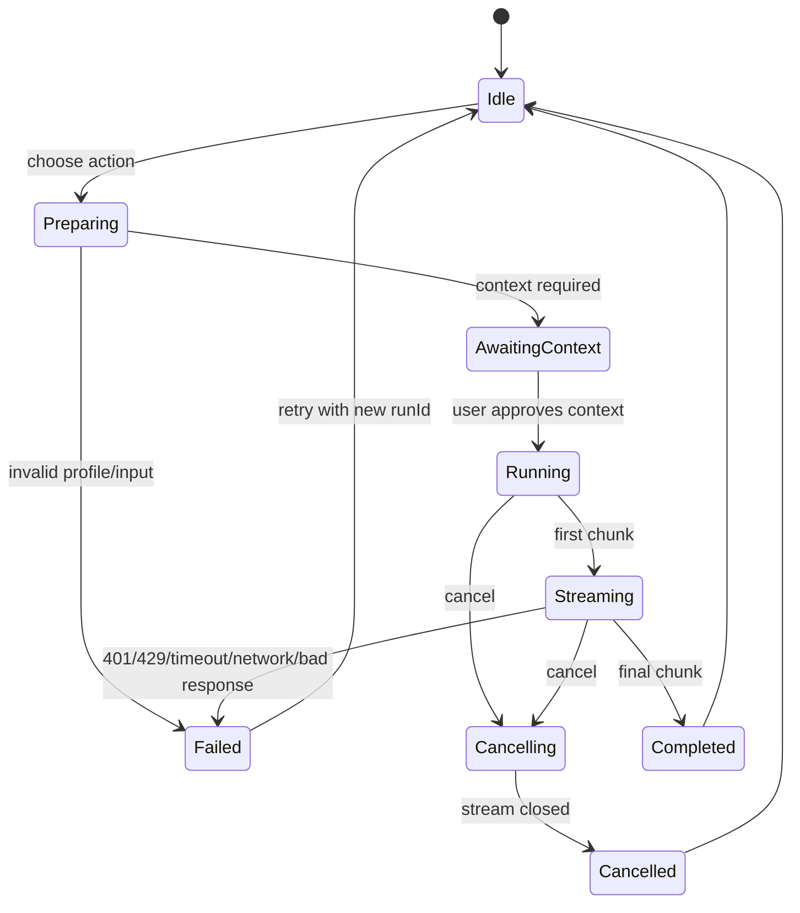

# 07 · UX-4 Optional Intelligence：AI Assistant 与 Server Inspector

## 1. 目标与边界

AI 是 Terminal 旁边的人工辅助能力，默认关闭，不是 Session owner、远程 Agent 或命令执行器。第一版只做：

- Explain Selection
- Explain Error
- Summarize Selected Output
- Draft Command
- Save as Snippet

Server Inspector 是同一阶段的可选只读扩展：用户在已连接 Session 上点击 Refresh，运行短时 probe，显示带 `observedAt`/`staleAfter` 的结果。它不是常驻采集器、时序数据库、告警平台或修复 Agent。

当前状态：AI/Inspector 均为 `DESIGN_ONLY`。`src-tauri/src/agent.rs` 是 SSH Agent 协议，不能写成 LLM Agent 已存在。

## 2. 技术决策：ModelDriver 优先于 Rig

### 事实

- 当前 `src-tauri/Cargo.toml` 的 `rust-version` 是 `1.96`。
- crates.io `rig-core@0.46.0` 当前元数据标为 `rust-version=1.97.1`；`cargo info` 只证明 crate 元数据，不证明加入本项目后所有目标和依赖通过。
- 当前项目没有 `rig-core`、ModelDriver、AI Profile 或 AI command。
- Rig 依赖、锁文件、audit、二进制体积和编译耗时不能沿用旧设计里的历史数字作为现状。

### 方案比较

| 方案 | 优点 | 工程代价/风险 | 判定 |
| --- | --- | --- | --- |
| A：直接集成 Rig 0.46 | Provider/Agent/Tool 抽象完整，后期多 Provider 方便 | MSRV 提升、Cargo.lock 重解析、依赖/审计/编译/体积成本；会把 MVP 与框架绑定 | 延后 |
| B：最小 ModelDriver + HTTP adapter | 只实现 OpenAI-compatible MVP，依赖少，易测取消/流式/错误，保持 Rust 1.96 | 后续 Provider/Tool 需要自己维护 adapter；不能提前享受 Rig 的高级抽象 | **推荐** |
| C：Node sidecar/Harness | 生态和 Provider 快 | 常驻进程、生命周期/安装/权限/打包复杂，违反本期不需要默认 sidecar 的边界 | 不采用 |

### 推荐决策

先实现最小 `ModelDriver` trait，OpenAI-compatible HTTP adapter 以已有 `reqwest` 为基础，放在 `ai` feature 后。待真实 MVP 证明需要多 Provider/Tool graph，再做独立 MSRV ADR 和 Rig adapter Spike；若采用 Rig，必须另行验证三平台、Cargo.lock、cargo audit、编译时间、二进制体积和默认 feature disabled 行为。

## 3. Model Profile

```ts
interface ModelProfilePublic {
  id: string
  name: string
  provider: 'openai-compatible' | 'anthropic' | 'local'
  endpoint: string
  modelId: string
  temperature: number | null
  maxOutputTokens: number
  timeoutMs: number
  streaming: boolean
  secretRef: string | null
  enabled: boolean
}

type ModelProfileStatus =
  | 'unconfigured'
  | 'requires-key'
  | 'testing'
  | 'reachable'
  | 'unauthorized'
  | 'rate-limited'
  | 'offline'
  | 'timeout'
  | 'unsupported'
```

SQLite 只保存公开 profile 和 `secretRef`：

```sql
ai_model_profiles(
  id TEXT PRIMARY KEY,
  name TEXT NOT NULL,
  provider TEXT NOT NULL,
  endpoint TEXT NOT NULL,
  model_id TEXT NOT NULL,
  temperature REAL,
  max_output_tokens INTEGER NOT NULL,
  timeout_ms INTEGER NOT NULL,
  streaming INTEGER NOT NULL,
  secret_ref TEXT,
  enabled INTEGER NOT NULL DEFAULT 1,
  created_at INTEGER NOT NULL,
  updated_at INTEGER NOT NULL
)
```

API Key 通过 Credential Provider 以 `model:<profileId>:<version>:apiKey` namespace 保存；普通前端查询、Extension API、日志和错误对象都不能返回 key。`ai_test_connection` 不读取 Terminal Context，也不执行远程命令。

Endpoint 规则：

- HTTPS 默认允许。
- localhost/127.0.0.1 的 HTTP 只为本地模型显式允许。
- 其他明文 HTTP 显示风险并要求确认，不在后台自动发送。
- 每次请求 UI 显示实际 endpoint/provider/model，避免用户把数据发到错误目标。

## 4. Rust ModelDriver 与 IPC

```rust
pub struct AiRequest {
    pub request_id: String,
    pub profile_id: String,
    pub action: AiAction,
    pub context: ApprovedContext,
    pub max_output_tokens: u32,
}

pub enum AiAction {
    ExplainSelection,
    ExplainError,
    SummarizeOutput,
    DraftCommand,
}

pub struct ApprovedContext {
    pub host_id: Option<String>,
    pub session_id: Option<String>,
    pub content_sha256: String,
    pub text: String,
}

#[async_trait]
pub trait ModelDriver: Send + Sync {
    async fn complete(
        &self,
        request: AiRequest,
        cancel: CancellationToken,
    ) -> Result<AiResponse, AiFailure>;
}
```

推荐 IPC：

- `ai_profiles_list`：公开字段，无 key。
- `ai_profile_upsert`：保存公开字段；API key 使用专门的 provider write action。
- `ai_profile_delete`：先移除 profile 引用，再清理 key；失败报告孤儿 Provider entry。
- `ai_test_connection`：不携带 Terminal Context。
- `ai_generate`：校验 `requestId`、上下文大小、profile 状态和 timeout。
- `ai_cancel`：按 `requestId` 取消，不接受模糊 host/session。

禁止 `read_secret(id)`、`execute_tool(name,args)`、`session_write_from_model` 这类通用命令。

## 5. Context Review

```ts
interface ContextSelection {
  kind: 'selection' | 'error' | 'output'
  hostId: string | null
  sessionId: string | null
  bytes: number
  contentSha256: string
  preview: string
  approved: boolean
  redactionEdits: Array<{ start: number; end: number; replacement: string }>
}
```

规则：

- 默认只取用户选中的终端文本或明确的错误片段，不自动上传整个 scrollback、clipboard、命令历史、环境变量、私钥、Vault 条目、团队 token 或远端文件。
- Preview 必须显示 Host 名、Session/Tab、字节数、Endpoint 和脱敏结果。
- 用户可删除/替换文本；提交前重新计算 `contentSha256`。
- Context size 超限时显示具体字节数和截断/缩小选择，不静默截断。
- 远端日志、Shell 输出和模型回复都视为不可信数据，必须转义显示，不能注入 HTML 或提升 Tool capability。

## 6. AI 状态机与 UI



AI Dock 包含：Profile Selector、Context Chips、Context Preview、单一 Composer、消息区、Cancel/Retry 和 Draft Card。关闭 Dock 的规则：

- 已批准的解释/摘要 Run 可以在有限时间内完成，但结果仍绑定原 `runId/Host/Session`，不能写入新 Host。
- 未批准的 Approval 立即失效。
- 取消操作发送 CancellationToken，迟到 chunk 被丢弃并记录 cancelled。
- 切 Tab/Host 不把旧消息显示为新 Session 的上下文；重新打开 Dock 可以查看原 Run 的终态。

## 7. 命令草稿与未来 Approval

MVP 只产生文本草稿：

- `Draft Command` 输出完整命令、目标 Host（如有）和风险说明。
- 用户可以 Copy 或 Save as Snippet；不自动调用 `session_write`。
- 如果未来增加“发送到 Shell”，Approval 必须绑定：
  `runId + hostId + sessionId + actionHash + exactInput + expiresAt + userGesture`。
- 任何 Host/Session/文本/参数变化都使 Approval 失效；双击只能消费一次。
- 未来 Tool Gateway 仍不能让模型直接读取 Secret、raw PTY 或决定目标 Session。

## 8. Server Inspector

### 目标

在已有 SSH Session 上按需读取 OS、Uptime/Load、CPU sample、Memory、Disk，显示采集方法和时间。没有真实数据就显示 `N/A`/Permission Denied/Stale，不画假曲线或 Healthy 百分比。

### 实现边界

- 优先设计 Rust typed read-only probe command；如果复用 `session_exec`，必须使用独立 channel/输出 sink，不能把 probe 文本写进用户 Shell 或 ACK 流。
- 每个 OS 只执行固定 allowlist 命令/参数，禁止把服务器返回值拼回命令。
- `ProbeResult` 必须带 `hostId/sessionId/observedAt/ttlMs/source/samplingWindow/metrics/error`。
- 同一 Host 同时只有一个 probe；切 Host 立即取消旧 probe，旧结果不得落到新卡片。
- 关闭 Dock 停止刷新；只保留短时内存 cache，不建历史时序表。
- “Open in Terminal”只聚焦已有 Host/Session，不自动写入或执行命令。

### Inspector 状态

`idle → queued → running → completed → stale`；权限、命令不存在、网络断开、Host 切换分别显示。Inspector 作为内置扩展候选，不阻塞 Core Release。

## 9. 安全威胁模型

| 威胁 | 防护 |
| --- | --- |
| Prompt Injection | 日志/模型输出只当数据；不提升 capability，不自动执行 |
| 恶意 Shell 建议 | 只作为草稿；Copy/Send/Tool 分开，Send 未来每次审批 |
| Secret 泄漏 | Context denylist、脱敏 preview、Provider namespace、日志扫描 |
| Host 混淆 | UI 显示 Host/Session/endpoint，request/approval 带稳定 ID |
| 旧响应写新 Session | runId + generation + sessionId 校验 |
| 重复审批 | actionHash + one-shot consume + expiry |
| Endpoint 风险 | HTTPS/localhost 规则、连接测试不带 Terminal Context |
| 超时/取消 | request/stream/driver CancellationToken；取消后丢弃迟到 chunk |
| AI/Inspector 故障影响终端 | 独立 Supervisor/feature flag；不触碰 SessionManager |

## 10. 测试矩阵

### ModelDriver/Provider

- profile CRUD、invalid URL/model/parameter、key 缺失、401/403/429、timeout、断流、坏 JSON、stream、cancel、retry 新 runId。
- 真实本地 fake HTTP server 覆盖所有状态；Mock PASS 与 `REAL_MODEL_E2E` 分开。
- API key 不出 SQLite、console、tracing、错误对象、测试 artifact。
- 默认 feature disabled 时无模型网络请求、无 profile UI 假入口、bundle 增量可量化。

### Context/Approval

- selection/error/output、脱敏、超长、空选择、IME Composer、Host 切换、Dock 关闭、迟到响应。
- Prompt Injection fixture、恶意命令、重复 Approve、过期/哈希变化/目标 Session 变化全部拒绝。

### Inspector

- Linux/macOS/Windows 可用/权限拒绝/command missing/断网/stale/切 Host/关闭 Dock。
- 不能污染交互 Shell；同 Host 单 probe；关闭后无 timer/process/Session 泄漏。

## 11. 完成定义

- AI 默认不启用且不影响 Core 启动、SSH、SFTP、PTY。
- 先完成 ModelDriver、Profile、Context Review 和只读动作；Rig 只有在独立 ADR 通过后才作为 adapter。
- Inspector 只读、按需、带来源和时间；不扩展成监控平台。
- 没有真实 Provider/GUI/跨平台证据的项保持 `NOT_RUN/BLOCKED`，不以设计图或本地 Mock 标成 PASS。
